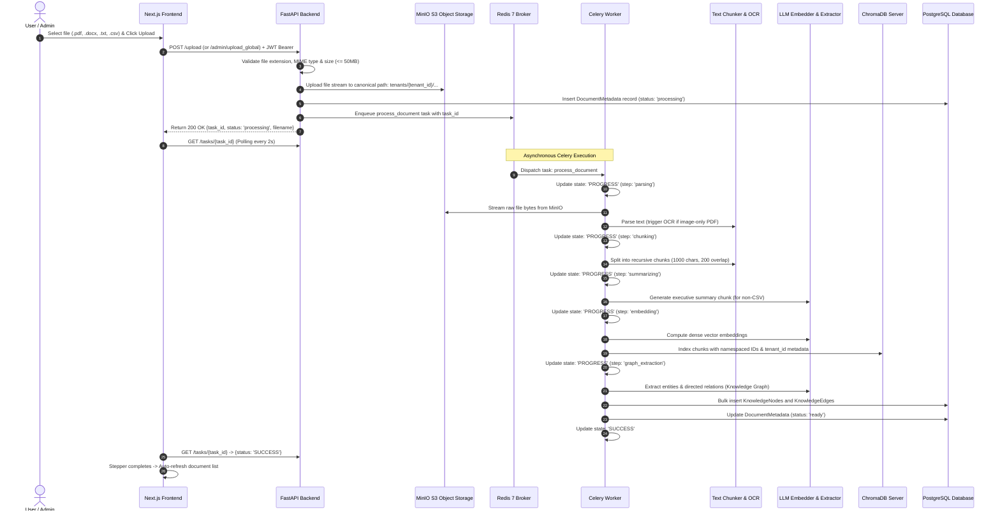
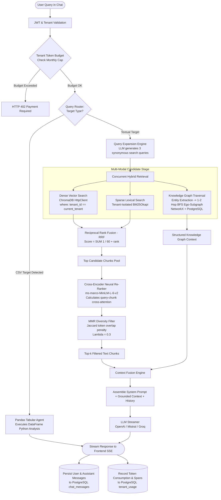

# System Architecture & Technical Specification

This document provides an exhaustive architectural reference for the **Enterprise Knowledge Bot**, detailing container topology, data flows, database schemas, multi-tenant isolation, distributed object storage, hybrid graph retrieval mechanisms, and production observability.

---

## 1. System Topology Overview

The system is deployed as a multi-tenant, microservices architecture coordinated via Docker Compose comprising 7 core services:

```mermaid
graph TB
    subgraph ClientLayer ["Client Layer"]
        UserBrowser["Web Browser (Member / Admin / SuperAdmin / PlatformAdmin)"]
    end

    subgraph FrontendApp ["Frontend Application"]
        NextJS["Next.js 15 (React 19, Tailwind CSS v4)<br/>Port: 3000 (Precision Dossier UI)"]
    end

    subgraph BackendAPI ["API & Application Server"]
        FastAPI["FastAPI Application Server<br/>Port: 8000"]
        AuthModule["Auth & Multi-Tenant RBAC Module<br/>(JWT, Bcrypt, Join-Codes)"]
        RouterEngine["Query Router (@global, !private, CSV)"]
        RetrieverFacade["Hybrid Retriever & Fusion Engine"]
        GraphEngine["Knowledge Graph Subgraph Engine"]
        TelemetryMeter["OpenTelemetry & Cost Meter"]
    end

    subgraph AsyncWorker ["Asynchronous Processing"]
        RedisQueue["Redis 7 Queue & Broker<br/>Port: 6379"]
        CeleryWorker["Celery Worker Process<br/>(OCR, Chunking, Embeddings, Graph Extraction)"]
    end

    subgraph DataStorage ["Persistent Data Layer"]
        PostgresDB[("PostgreSQL 15 (chatdb)<br/>Port: 5433<br/>Tenants, Users, Sessions, Graph, Usage")]
        ChromaServer[("ChromaDB Standalone HTTP Server<br/>Port: 8001 (knowledge_base collection)")]
        MinIOStorage[("MinIO S3 Object Storage<br/>Ports: 9010 (API) / 9011 (Console)<br/>Canonical Multi-Tenant Bucket")]
    end

    subgraph ExternalLLMs ["External Model Providers"]
        OpenAIAPI["OpenAI API (GPT-4o-mini, text-embedding-3-small)"]
        MistralAPI["Mistral API (mistral-small, mistral-embed)"]
        GroqAPI["Groq LPU (gpt-oss-120b)"]
    end

    UserBrowser -->|HTTP / SSE| NextJS
    NextJS -->|REST API / Token Streaming| FastAPI
    FastAPI --> AuthModule
    FastAPI --> RouterEngine
    FastAPI --> RetrieverFacade
    FastAPI --> GraphEngine
    FastAPI --> TelemetryMeter
    FastAPI -->|Enqueue Ingestion Tasks| RedisQueue
    RedisQueue -->|Dispatch Task| CeleryWorker
    CeleryWorker -->|Read Document Stream| MinIOStorage
    CeleryWorker -->|Store Vectors & Metadata| ChromaServer
    CeleryWorker -->|Persist Nodes & Edges| PostgresDB
    FastAPI -->|Read/Write Tenants, Users, Sessions, Graph, Usage| PostgresDB
    FastAPI -->|Presigned GET/PUT URLs| MinIOStorage
    RetrieverFacade -->|Dense Search (tenant_id filtered)| ChromaServer
    RetrieverFacade -->|Traverse Ego-Subgraph| GraphEngine
    FastAPI -->|Streaming LLM Prompts| ExternalLLMs
    CeleryWorker -->|Generate Embeddings| ExternalLLMs
```

---

## 2. Ingestion Pipeline & Real-Time Stepper

Document uploads are handled asynchronously via distributed object storage and Celery workers to ensure non-blocking API operations and high throughput:



---

## 3. Advanced Hybrid Retrieval & Generation Pipeline

The retrieval engine combines dense semantic search, sparse lexical BM25 matching, Knowledge Graph ego-subgraph traversal, Cross-Encoder re-ranking, and Maximal Marginal Relevance (MMR) diversity:



---

## 4. Complete Relational Database Schema (`PostgreSQL 15`)

The relational database is managed via SQLAlchemy ORM with automatic schema migrations. Complete enterprise entities include:

### `tenants` Table
Represents isolated corporate organizations.
| Column | Type | Constraints | Description |
|---|---|---|---|
| `id` | `Integer` | `PRIMARY KEY`, Index | Unique organization identifier |
| `name` | `String(255)` | `UNIQUE`, Not Null | Corporate organization name |
| `join_code` | `String(32)` | `UNIQUE`, Not Null | Cryptographic join code for employee onboarding |
| `status` | `String(32)` | Default: `'active'` | Organization status (`'active'`, `'suspended'`) |
| `created_at` | `DateTime` | Default: `utcnow` | Organization creation timestamp |

### `users` Table
Stores authenticated user accounts, roles, and organization tenancy.
| Column | Type | Constraints | Description |
|---|---|---|---|
| `id` | `Integer` | `PRIMARY KEY`, Index | Unique user identifier |
| `tenant_id` | `Integer` | `FOREIGN KEY(tenants.id)`, Index | Associated organization |
| `username` | `String(255)` | `UNIQUE`, Index | User login handle |
| `hashed_password` | `String(255)` | Not Null | Bcrypt salted hash |
| `role` | `String(32)` | Default: `'user'` | Role tier: `'superadmin'`, `'admin'`, `'editor'`, `'user'` |
| `is_platform_admin`| `Boolean` | Default: `False` | Platform superuser flag (cross-tenant audit) |
| `is_active` | `Boolean` | Default: `True` | Account active state |
| `created_at` | `DateTime` | Default: `utcnow` | Registration timestamp |

### `chat_sessions` Table
Persists multi-chat conversation threads per tenant and user.
| Column | Type | Constraints | Description |
|---|---|---|---|
| `id` | `Integer` | `PRIMARY KEY`, Index | Unique session identifier |
| `tenant_id` | `Integer` | `FOREIGN KEY(tenants.id)`, Index | Tenant boundary |
| `user_id` | `Integer` | `FOREIGN KEY(users.id)`, Index | Owner user identifier |
| `title` | `String(255)` | Default: `'New Chat'` | Conversation thread title |
| `created_at` | `DateTime` | Default: `utcnow` | Creation timestamp |

### `chat_messages` Table
Stores individual turns within a conversation thread.
| Column | Type | Constraints | Description |
|---|---|---|---|
| `id` | `Integer` | `PRIMARY KEY`, Index | Unique message identifier |
| `session_id` | `Integer` | `FOREIGN KEY(chat_sessions.id)`, Index | Parent conversation thread |
| `role` | `String(32)` | Not Null | Turn speaker: `'user'` or `'assistant'` |
| `content` | `Text` | Not Null | Full text or Markdown content |
| `timestamp` | `DateTime` | Default: `utcnow` | Message timestamp |

### `access_requests` Table
Tracks user requests for elevated privilege tiers within a tenant.
| Column | Type | Constraints | Description |
|---|---|---|---|
| `id` | `Integer` | `PRIMARY KEY`, Index | Unique request identifier |
| `tenant_id` | `Integer` | `FOREIGN KEY(tenants.id)`, Index | Organization boundary |
| `user_id` | `Integer` | `FOREIGN KEY(users.id)`, Index | Requesting user identifier |
| `requested_role` | `String(32)` | Not Null | Target role (`'editor'` or `'admin'`) |
| `status` | `String(32)` | Default: `'pending'` | Status: `'pending'`, `'approved'`, `'rejected'` |
| `created_at` | `DateTime` | Default: `utcnow` | Request submission timestamp |

### `document_metadata` Table
Catalogs all uploaded documents, canonical storage keys, and processing stages.
| Column | Type | Constraints | Description |
|---|---|---|---|
| `id` | `Integer` | `PRIMARY KEY`, Index | Unique document record identifier |
| `tenant_id` | `Integer` | `FOREIGN KEY(tenants.id)`, Index | Owning tenant |
| `user_id` | `Integer` | `FOREIGN KEY(users.id)`, Index | Uploading user |
| `filename` | `String(255)` | Not Null | Sanitized base file name |
| `canonical_key` | `String(512)` | Not Null, Index | MinIO/S3 object key |
| `file_type` | `String(32)` | Not Null | Extension (`.pdf`, `.docx`, `.txt`, `.csv`) |
| `is_global` | `Integer` | Default: `0` | Global enterprise corpus indicator (`0` or `1`) |
| `status` | `String(32)` | Default: `'processing'` | Ingestion state: `'processing'`, `'ready'`, `'failed'` |
| `created_at` | `DateTime` | Default: `utcnow` | Ingestion timestamp |

### `tenant_usage` Table
Records monthly LLM token consumption and cost tracking.
| Column | Type | Constraints | Description |
|---|---|---|---|
| `id` | `Integer` | `PRIMARY KEY`, Index | Unique record identifier |
| `tenant_id` | `Integer` | `FOREIGN KEY(tenants.id)`, Index | Associated tenant |
| `year_month` | `String(7)` | Not Null, Index | Billing period (`YYYY-MM`) |
| `prompt_tokens` | `Integer` | Default: `0` | Total input prompt tokens |
| `completion_tokens`| `Integer`| Default: `0` | Total completion tokens |
| `total_tokens` | `Integer` | Default: `0` | Aggregate tokens consumed |
| `token_budget` | `Integer` | Default: `1,000,000` | Configured monthly token cap |
| `updated_at` | `DateTime` | Default: `utcnow` | Last activity timestamp |

### `knowledge_nodes` Table
Persists Knowledge Graph entities extracted from ingested enterprise documents.
| Column | Type | Constraints | Description |
|---|---|---|---|
| `id` | `Integer` | `PRIMARY KEY`, Index | Node surrogate ID |
| `tenant_id` | `Integer` | `FOREIGN KEY(tenants.id) ON DELETE CASCADE` | Strict tenant partition |
| `entity_id` | `String(128)`| Not Null, Index | Normalized alphanumeric entity slug |
| `name` | `String(255)`| Not Null | Human-readable entity name |
| `entity_type` | `String(64)` | Not Null, Index | Entity category (`INCIDENT`, `SYSTEM`, `POLICY`, etc.) |
| `description` | `Text` | Nullable | Contextual entity description |
| `source_documents`| `JSON` | Not Null | Array of contributing document filenames |
| `properties_json` | `JSON` | Not Null | Extracted properties & metadata |
| `created_at` | `DateTime` | Default: `utcnow` | Extraction timestamp |

### `knowledge_edges` Table
Persists directed semantic relationships between Knowledge Graph entities.
| Column | Type | Constraints | Description |
|---|---|---|---|
| `id` | `Integer` | `PRIMARY KEY`, Index | Edge surrogate ID |
| `tenant_id` | `Integer` | `FOREIGN KEY(tenants.id) ON DELETE CASCADE` | Strict tenant partition |
| `source_entity_id`| `String(128)`| Not Null, Index | Outgoing entity identifier |
| `target_entity_id`| `String(128)`| Not Null, Index | Incoming entity identifier |
| `relation_type` | `String(64)` | Not Null, Index | Directed relation (`AFFECTS`, `GOVERNS`, etc.) |
| `weight` | `Float` | Default: `1.0` | Relationship frequency / importance weight |
| `context_snippet` | `Text` | Nullable | Document excerpt evidencing the relationship |
| `source_document` | `String(255)`| Not Null | Source document name |
| `properties_json` | `JSON` | Not Null | Extracted relationship properties |
| `created_at` | `DateTime` | Default: `utcnow` | Extraction timestamp |

---

## 5. Multi-Tenant Vector & Storage Isolation Scheme

### ChromaDB Chunk Metadata Schema:
All document chunks reside in the standalone ChromaDB `knowledge_base` collection with strict tenant and access partitioning:
```json
{
  "chunk_id": "t1_g_company_policy_chunk_0003",
  "source": "company_policy.pdf",
  "page": 2,
  "tenant_id": 1,
  "user_id": 4,
  "is_global": 1,
  "is_summary": false,
  "file_type": ".pdf"
}
```

### Retrieval Filter Predicates:
Every query enforces tenant isolation at the vector engine level:
```python
# General tenant query (member's personal docs + tenant global docs):
where_filter = {
    "$and": [
        {"tenant_id": current_user.tenant_id},
        {
            "$or": [
                {"user_id": current_user.id},
                {"is_global": 1}
            ]
        }
    ]
}

# Tagged document query (@global_doc or !personal_doc):
where_filter = {
    "$and": [
        {"tenant_id": current_user.tenant_id},
        {"source": target_filename},
        {
            "$or": [
                {"user_id": current_user.id},
                {"is_global": 1}
            ]
        }
    ]
}
```

### MinIO/S3 Canonical Storage Keys:
Files are stored strictly within tenant namespaces:
- **Personal documents:** `tenants/{tenant_id}/users/{user_id}/{sanitized_filename}`
- **Global enterprise documents:** `tenants/{tenant_id}/global/{sanitized_filename}`

---

## 6. Multi-Tenant Knowledge Graph Engine

The Knowledge Graph combines sub-millisecond in-memory graph traversals with persistent relational durability:

1. **Storage Topology:**
   - **Persistence:** PostgreSQL `knowledge_nodes` and `knowledge_edges` tables.
   - **In-Memory Store:** `NetworkXGraphStore` maintaining thread-safe `networkx.MultiDiGraph` instances per tenant. Graphs are lazy-loaded upon first tenant query and kept synchronized on writes.
2. **Entity Types & Relationships:**
   - Recognized entity classes: `INCIDENT`, `SYSTEM`, `POLICY`, `DEPARTMENT`, `ORGANIZATION`, `METRIC`, `PERSON`.
   - Directed relationship types: `AFFECTS`, `GOVERNS`, `RESOLVED`, `MANDATES`, `REPORTED`, `OPERATES`.
3. **Multi-Hop Traversal Algorithm:**
   - Query entities extracted via regex and LLM pattern matchers.
   - BFS ego-subgraph search up to `GRAPH_MAX_HOPS` (default: 2 hops) capped at `GRAPH_MAX_SUBGRAPH_NODES` (default: 30 nodes).
   - Degree centrality ranking selects the most connected contextual seed nodes.
4. **Cascade Deletion:**
   - Deleting a document purges all associated edges and prunes orphaned nodes from both memory and PostgreSQL.
   - Deleting or offboarding a tenant cascades to all nodes and edges via PostgreSQL foreign key constraints.

---

## 7. Observability, Telemetry & Cost Governance

The system integrates continuous tracing and multi-tenant cost controls:

1. **OpenTelemetry Telemetry Meter:**
   - Structured tracing spans instrument `/query`, `/upload`, vector retrieval, graph traversal, and LLM streaming.
2. **Tenant Token Accounting:**
   - Real-time token consumption meters prompt tokens, completion tokens, and dollar expenditures.
3. **Hard Monthly Budget Caps:**
   - Organizations configure a monthly token limit (`token_budget`). When `total_tokens >= token_budget`, API endpoints return `HTTP 402 Payment Required`, preventing runaway spend.
4. **CSV Usage Exporter:**
   - Admins can export monthly token analytics via `GET /telemetry/export`.

---

## 8. Multi-Provider LLM & Embedding Compatibility

| Configuration (`LLM_PROVIDER`) | Generator LLM | Embedding Model | Vector Dimension |
|---|---|---|---|
| `openai` (Default) | `gpt-4o-mini` | `text-embedding-3-small` | 1536 |
| `mistral` | `mistral-small-latest` | `mistral-embed` | 1536 |
| `groq` | `openai/gpt-oss-120b` | Local `all-MiniLM-L6-v2` | 384 |

> [!IMPORTANT]
> When switching `LLM_PROVIDER` between models with different embedding dimensions (e.g. OpenAI 1536 $\leftrightarrow$ Groq 384), the vector index must be cleared and re-indexed to prevent dimension mismatch errors.
