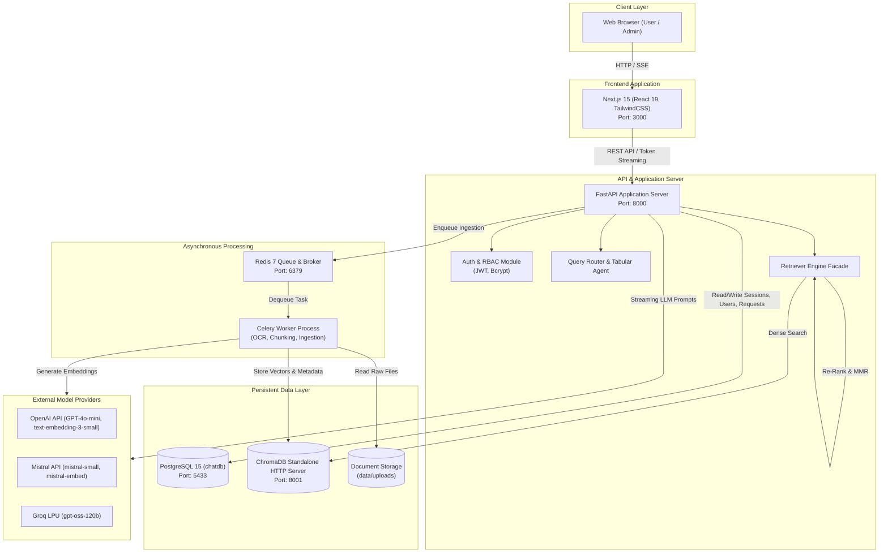
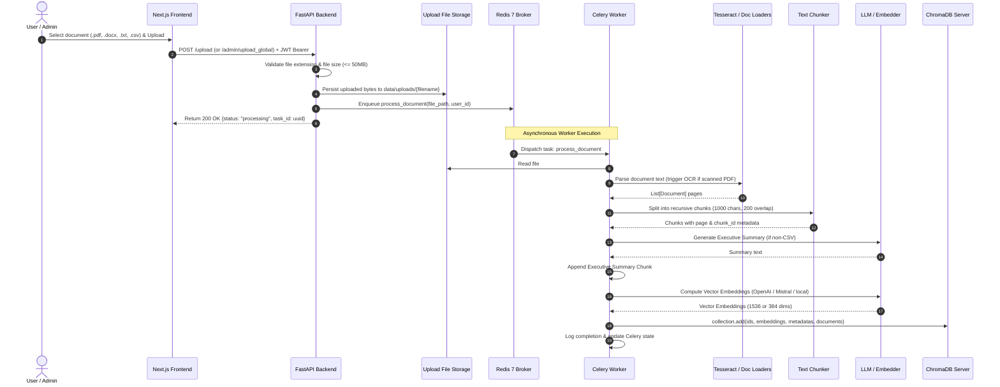
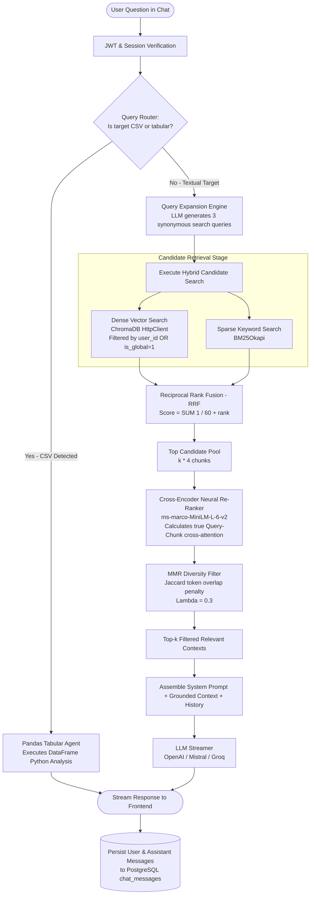

# System Architecture & Technical Specification

This document provides an exhaustive architectural reference for the **Enterprise Knowledge Bot**, detailing container topology, data flows, database schemas, retrieval mechanisms, and security isolation guarantees.

---

## 1. System Topology Overview

The system is deployed as a fully containerized microservices architecture coordinated via Docker Compose:



---

## 2. Ingestion Pipeline Architecture

Document uploads are handled asynchronously to ensure zero UI freezing or API request timeouts when ingesting massive or OCR-heavy files.



---

## 3. Advanced Retrieval & Generation Pipeline

The retrieval pipeline uses a multi-stage approach combining query expansion, sparse/dense hybrid search with Reciprocal Rank Fusion, Cross-Encoder re-ranking, and Maximal Marginal Relevance.



---

## 4. Relational Database Schema (`PostgreSQL`)

The database is managed via SQLAlchemy ORM. The core relational entities are:

### `users` Table
Stores authenticated user accounts and assigned roles.
| Column | Type | Constraints | Description |
|---|---|---|---|
| `id` | `Integer` | `PRIMARY KEY`, Index | Unique user identifier |
| `username` | `String` | `UNIQUE`, Index | User login name |
| `hashed_password` | `String` | Not Null | Bcrypt salted hash |
| `role` | `String` | Default: `'user'` | Role tier: `'user'`, `'editor'`, or `'admin'` |
| `created_at` | `DateTime` | Default: `utcnow` | Account creation timestamp |

### `chat_sessions` Table
Persists multi-chat conversation threads per user.
| Column | Type | Constraints | Description |
|---|---|---|---|
| `id` | `Integer` | `PRIMARY KEY`, Index | Unique session identifier |
| `user_id` | `Integer` | `FOREIGN KEY(users.id)` | Owner user identifier |
| `title` | `String` | Default: `'New Chat'` | Conversation thread title |
| `created_at` | `DateTime` | Default: `utcnow` | Creation timestamp |

### `chat_messages` Table
Stores individual turns within a conversation thread.
| Column | Type | Constraints | Description |
|---|---|---|---|
| `id` | `Integer` | `PRIMARY KEY`, Index | Unique message identifier |
| `session_id` | `Integer` | `FOREIGN KEY(chat_sessions.id)` | Parent conversation session |
| `role` | `String` | Not Null | Turn speaker: `'user'` or `'assistant'` |
| `content` | `Text` | Not Null | Full text or Markdown content |
| `timestamp` | `DateTime` | Default: `utcnow` | Timestamp of message |

### `access_requests` Table
Tracks user requests for elevated privilege tiers.
| Column | Type | Constraints | Description |
|---|---|---|---|
| `id` | `Integer` | `PRIMARY KEY`, Index | Unique request identifier |
| `user_id` | `Integer` | `FOREIGN KEY(users.id)` | Requesting user |
| `requested_role` | `String` | Not Null | Target role (`'editor'` or `'admin'`) |
| `status` | `String` | Default: `'pending'` | Status: `'pending'`, `'approved'`, `'rejected'` |
| `created_at` | `DateTime` | Default: `utcnow` | Request submission timestamp |

---

## 5. Vector Store & Multi-Tenant Metadata Scheme

All document chunks reside in ChromaDB under the `knowledge_base` collection. Complete tenant isolation is enforced at query time using ChromaDB metadata predicates.

### Metadata Schema per Chunk:
```json
{
  "source": "Q3_Financial_Review.pdf",
  "chunk_id": "Q3_Financial_Review_chunk_0012",
  "page": 4,
  "user_id": 14,
  "is_global": 0,
  "is_summary": false,
  "file_type": ".pdf"
}
```

### Retrieval Filter Logic:
When user $U_{id}$ queries the vector store:
```python
# If querying all accessible documents:
where_filter = {
    "$or": [
        {"user_id": current_user.id},
        {"is_global": 1}
    ]
}

# If user tagged a specific document with !filename:
where_filter = {
    "$and": [
        {"source": target_file},
        {
            "$or": [
                {"user_id": current_user.id},
                {"is_global": 1}
            ]
        }
    ]
}
```
This mathematically prevents any user from retrieving chunks belonging to another user, while allowing shared access to admin-approved global enterprise documents.

---

## 6. Multi-Provider LLM & Embedding Alignment

Vector compatibility is guaranteed by strictly pairing embedding models with compatible dimensionality:

| Configuration (`LLM_PROVIDER`) | Generator LLM | Embedding Model | Vector Dimension |
|---|---|---|---|
| `openai` (Default) | `gpt-4o-mini` | `text-embedding-3-small` | 1536 |
| `mistral` | `mistral-small-latest` | `mistral-embed` | 1536 |
| `groq` | `openai/gpt-oss-120b` | Local `all-MiniLM-L6-v2` | 384 |

> [!IMPORTANT]
> If `LLM_PROVIDER` is changed between providers with different vector dimensions (e.g. OpenAI $\leftrightarrow$ Groq), the ChromaDB collection must be cleared and re-indexed to prevent dimension mismatch errors.
