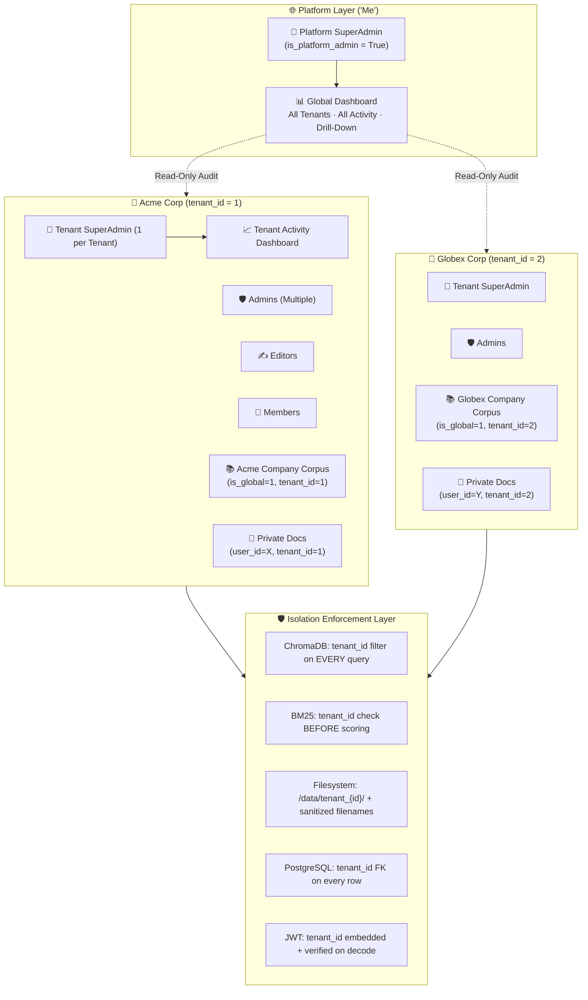

# Enterprise Multi-Tenancy Architecture — Hardened Edition

> [!IMPORTANT]
> **Status:** Implementation plan pending user execution approval.
> **Revision:** v3 — Security audit applied. 14 loopholes identified, analyzed, and patched.

---

## Table of Contents

1. [System Architecture](#1-system-architecture--dual-tier-governance)
2. [Role Hierarchy](#2-role-hierarchy--permission-matrix)
3. [Security Audit: 14 Loopholes Found & Fixed](#3-security-audit--loophole-analysis)
4. [Database Schema (Hardened)](#4-database-schema-hardened)
5. [Vector & Search Isolation (Hardened)](#5-vector--search-isolation-hardened)
6. [Storage & Tabular Isolation (Hardened)](#6-storage--tabular-isolation-hardened)
7. [Auth & JWT (Hardened)](#7-auth--jwt-hardened)
8. [Activity Logging Engine](#8-activity-logging-engine)
9. [Dual-Tier Dashboards](#9-dual-tier-dashboard-specifications)
10. [Migration & Bootstrap](#10-migration--bootstrapping-plan)
11. [Phased Execution Roadmap](#11-phased-execution-roadmap)

---

## 1. System Architecture & Dual-Tier Governance



---

## 2. Role Hierarchy & Permission Matrix

| Role | Scope | Quota | Capabilities | Restrictions |
| :--- | :--- | :---: | :--- | :--- |
| **Platform SuperAdmin** | System-Wide | Designated accounts (`is_platform_admin=True`) | Global Dashboard (`/platform-admin`), view all tenants/users/activity, tenant status management, drill-down into any company | Cannot modify tenant data directly; read-only audit access to tenant internals |
| **Tenant SuperAdmin** | Single Tenant | **Exactly 1** | Full company control, promote/demote any member including admins, manage company corpus, **exclusive:** atomic ownership transfer, Tenant Activity Dashboard | Cannot be demoted by anyone; always exactly one per tenant |
| **Tenant Admin** | Single Tenant | Multiple (≥0) | Manage company corpus (upload/delete), promote/demote `editor`↔`user`, approve role requests, view company telemetry | Cannot touch `superadmin` or other `admin`s, cannot promote to `admin` or transfer ownership |
| **Tenant Editor** | Single Tenant | Multiple | Upload/delete company corpus docs, manage personal docs, query company + personal repos | No member management or admin access |
| **Tenant Member** (`user`) | Single Tenant | Multiple | Manage personal docs, query company + personal repos, submit role requests | Read-only company corpus access; no admin controls |

---

## 3. Security Audit & Loophole Analysis

> [!CAUTION]
> The following 14 vulnerabilities were identified in the original plan and current codebase. Each is paired with a concrete fix that will be implemented.

### LOOPHOLE 1: Open Company Join — No Invitation Gate
**Severity:** 🔴 CRITICAL
**Current behavior:** The registration plan allows anyone who types a company name (e.g., "Acme Corp") to instantly join that company and gain access to the entire Company Corpus.
**Attack vector:** Adversary discovers a company name, registers, and immediately reads all company-wide documents.
**Fix:**
```python
# Registration flow with join-code protection:
class UserCreate(BaseModel):
    company_name: str     # Required for all registrations
    username: str
    password: str
    join_code: Optional[str] = None  # Required when joining EXISTING company

# If company exists:
#   - Require a valid join_code (generated by Tenant SuperAdmin/Admin)
#   - New user starts as role="user" with status="pending_approval"
#   - Tenant Admin must explicitly approve the membership
# If company is new:
#   - Create tenant, user becomes superadmin (no join_code needed)
```

### LOOPHOLE 2: JWT Contains No Tenant Context — Tenant-Hopping Risk
**Severity:** 🔴 CRITICAL
**Current behavior:** JWT payload is `{"sub": "username"}`. If `tenant_id` is only read from the database at request time, a compromised database update could silently move a user between tenants.
**Fix:**
```python
# Embed tenant_id and role directly in the JWT:
def create_access_token(data: dict):
    to_encode = data.copy()
    # data must include: {"sub": username, "tenant_id": int, "role": str, "is_platform_admin": bool}
    expire = datetime.utcnow() + timedelta(minutes=ACCESS_TOKEN_EXPIRE_MINUTES)
    to_encode.update({"exp": expire})
    return jwt.encode(to_encode, SECRET_KEY, algorithm=ALGORITHM)

# On every request, verify JWT tenant_id matches DB tenant_id:
def get_current_user(token, db):
    payload = jwt.decode(token, SECRET_KEY, algorithms=[ALGORITHM])
    user = db.query(User).filter(User.username == payload["sub"]).first()
    if user.tenant_id != payload["tenant_id"]:
        raise HTTPException(403, "Token tenant mismatch — re-authenticate")
    return user
```

### LOOPHOLE 3: `/admin/make_me_admin` — Unauthenticated Privilege Escalation Backdoor
**Severity:** 🔴 CRITICAL
**Current behavior:** [`api/admin.py:84-93`](file:///h:/Documents/Hassan/coding_projects/enterprise-knowledge-bot/knowledge-bot/api/admin.py#L84-L93) has a `/admin/make_me_admin` endpoint with **NO authentication** that promotes the first user to admin.
**Fix:** Remove this endpoint entirely. The bootstrap is handled by: first user registering a new company automatically becomes `superadmin`.

### LOOPHOLE 4: BM25 Cross-Tenant Score Leakage
**Severity:** 🟠 HIGH
**Current behavior:** [`vector_store.py:137-158`](file:///h:/Documents/Hassan/coding_projects/enterprise-knowledge-bot/knowledge-bot/src/retrieval/vector_store.py#L137-L158) — `_build_bm25()` loads ALL documents from ALL tenants into a single in-memory BM25 index. Tenant filtering happens *after* BM25 scoring. This means:
- Cross-tenant documents inflate/deflate IDF scores (statistical leakage)
- A tenant with 1 document scores against a corpus of 100K cross-tenant documents (wasted compute)
- Memory grows with total platform size, not per-tenant
**Fix:** Build **per-tenant BM25 indices**:
```python
# In VectorStore:
self._bm25_indices: dict[int, tuple[BM25Okapi, list[Document]]] = {}

def _build_bm25_for_tenant(self, tenant_id: int):
    """Build or rebuild BM25 index for a specific tenant only."""
    all_data = self._collection.get(
        where={"tenant_id": tenant_id},
        include=["documents", "metadatas"]
    )
    # ... build BM25Okapi from filtered documents only

def bm25_search(self, query, user_id, tenant_id, ...):
    """Score only within the tenant's own BM25 index."""
    bm25, docs = self._bm25_indices.get(tenant_id, (None, []))
    # ... score and filter by user_id/is_global within tenant
```

### LOOPHOLE 5: Filesystem Path Traversal
**Severity:** 🟠 HIGH
**Current behavior:** Filenames are used directly in paths (`UPLOAD_DIR / filename`). A crafted filename like `../../etc/passwd` or `../tenant_2/secret.csv` could traverse directories.
**Fix:**
```python
from pathlib import PurePosixPath

def sanitize_filename(filename: str) -> str:
    """Strip any path traversal components, keep only the basename."""
    # Remove all directory components
    clean = PurePosixPath(filename).name
    # Remove null bytes and other dangerous characters
    clean = clean.replace('\x00', '').strip()
    if not clean or clean.startswith('.'):
        raise HTTPException(400, "Invalid filename")
    return clean

# Usage in upload:
safe_name = sanitize_filename(file.filename)
tenant_dir = UPLOAD_DIR / f"tenant_{current_user.tenant_id}"
tenant_dir.mkdir(parents=True, exist_ok=True)
save_path = tenant_dir / safe_name
```

### LOOPHOLE 6: `delete_source` Cross-Tenant Collision
**Severity:** 🟠 HIGH
**Current behavior:** [`vector_store.py:440-480`](file:///h:/Documents/Hassan/coding_projects/enterprise-knowledge-bot/knowledge-bot/src/retrieval/vector_store.py#L440-L480) — `delete_source(filename, user_id)` filters by `source` + `user_id` but not `tenant_id`. If Tenant A and Tenant B both have `Report.csv`, and user_id happens to be `None` (company-wide), the delete could hit both tenants' documents.
**Fix:**
```python
def delete_source(self, source_filename: str, user_id: Optional[int] = None, tenant_id: Optional[int] = None) -> int:
    conditions = [{"source": source_filename}]
    if tenant_id is not None:
        conditions.append({"tenant_id": tenant_id})
    if user_id is not None:
        conditions.append({"user_id": user_id})
    where = {"$and": conditions} if len(conditions) > 1 else conditions[0]
    # ... delete only matching chunks
```

### LOOPHOLE 7: SuperAdmin Transfer — No Target Confirmation
**Severity:** 🟡 MEDIUM
**Original plan:** SuperAdmin transfers ownership unilaterally. The target user has no say.
**Fix:** Two-step handshake:
1. SuperAdmin initiates transfer → creates a `PendingTransfer` record with expiry (24h).
2. Target user must explicitly accept via `/admin/accept_transfer/{transfer_id}`.
3. If not accepted within 24h, transfer expires automatically.
```python
class PendingTransfer(Base):
    __tablename__ = "pending_transfers"
    id = Column(Integer, primary_key=True)
    tenant_id = Column(Integer, ForeignKey("tenants.id"), nullable=False)
    from_user_id = Column(Integer, ForeignKey("users.id"), nullable=False)
    to_user_id = Column(Integer, ForeignKey("users.id"), nullable=False)
    status = Column(String, default="pending") # 'pending', 'accepted', 'expired', 'cancelled'
    created_at = Column(DateTime, default=datetime.utcnow)
    expires_at = Column(DateTime)  # created_at + 24 hours
```

### LOOPHOLE 8: Activity Log Write Amplification — Synchronous Blocking
**Severity:** 🟡 MEDIUM
**Original plan:** `log_activity()` does a synchronous `db.commit()` inside the request path.
**Impact:** Every query, upload, and login adds ~2-5ms of database write latency to the critical path.
**Fix:** Fire-and-forget via Celery (reuse existing worker infrastructure):
```python
# In src/worker.py — add async activity logging task:
@celery_app.task(name="log_activity_async")
def log_activity_async(tenant_id, user_id, action, category, description, details_json):
    from src.database import SessionLocal
    from src.models import ActivityLog
    with SessionLocal() as db:
        entry = ActivityLog(
            tenant_id=tenant_id, user_id=user_id,
            action=action, category=category,
            description=description, details=details_json
        )
        db.add(entry)
        db.commit()

# In API endpoints — zero latency overhead:
log_activity_async.delay(tenant_id, user_id, "QUERY_EXECUTED", "QUERY", ...)
```

### LOOPHOLE 9: Registration Race Condition — Company Name Collision
**Severity:** 🟡 MEDIUM
**Scenario:** Two users register simultaneously with `company_name = "Acme Corp"`. Both check that the tenant doesn't exist, both try to create it. Result: duplicate tenants or database constraint error with no graceful handling.
**Fix:** Database-level unique constraint on `tenants.slug` + application-level retry:
```python
@router.post("/register")
def register(user_data: UserCreate, db: Session = Depends(get_db)):
    slug = slugify(user_data.company_name)
    try:
        # Attempt atomic tenant creation inside a savepoint
        tenant = db.query(Tenant).filter(Tenant.slug == slug).with_for_update().first()
        if tenant is None:
            tenant = Tenant(name=user_data.company_name, slug=slug)
            db.add(tenant)
            db.flush()  # Get the ID, but don't commit yet
            is_founder = True
        else:
            is_founder = False
            # Validate join_code here...
        # ... create user with tenant_id = tenant.id
        db.commit()
    except IntegrityError:
        db.rollback()
        raise HTTPException(409, "Company registration conflict, please retry")
```

### LOOPHOLE 10: CORS Wildcard in Production
**Severity:** 🟡 MEDIUM
**Current behavior:** [`api/main.py:28`](file:///h:/Documents/Hassan/coding_projects/enterprise-knowledge-bot/knowledge-bot/api/main.py#L28) — `allow_origins=["*"]`.
**Impact:** Any website in the world can make authenticated API requests to the backend if a user's JWT is compromised.
**Fix:** Restrict to the actual frontend origin:
```python
CORS_ORIGINS = os.getenv("CORS_ORIGINS", "http://192.168.1.92:3000").split(",")
app.add_middleware(CORSMiddleware, allow_origins=CORS_ORIGINS, ...)
```

### LOOPHOLE 11: SuperAdmin Self-Deletion — Orphaned Tenant
**Severity:** 🟡 MEDIUM
**Scenario:** SuperAdmin deletes their own account. The tenant becomes permanently orphaned with no owner and no way to recover.
**Fix:** Block self-deletion for SuperAdmin at the API level. They must transfer ownership first:
```python
@app.delete("/auth/delete_account")
def delete_account(current_user, db):
    if current_user.role == "superadmin":
        raise HTTPException(400, "Transfer SuperAdmin ownership before deleting your account.")
    # ... proceed with deletion
```

### LOOPHOLE 12: No Activity Log Retention Policy
**Severity:** 🟢 LOW
**Impact:** `activity_logs` table grows unboundedly. After months of operation with many tenants, dashboard queries slow down dramatically.
**Fix:** Add index on `(tenant_id, timestamp)` and implement automatic cleanup:
```python
# Index for efficient dashboard queries:
Index("ix_activity_tenant_time", ActivityLog.tenant_id, ActivityLog.timestamp)

# Configurable retention (default 90 days):
ACTIVITY_LOG_RETENTION_DAYS = int(os.getenv("ACTIVITY_LOG_RETENTION_DAYS", "90"))

# Periodic cleanup (Celery beat or startup hook):
@celery_app.task(name="cleanup_old_activity_logs")
def cleanup_old_activity_logs():
    cutoff = datetime.utcnow() - timedelta(days=ACTIVITY_LOG_RETENTION_DAYS)
    with SessionLocal() as db:
        db.query(ActivityLog).filter(ActivityLog.timestamp < cutoff).delete()
        db.commit()
```

### LOOPHOLE 13: chunk_id Collision Across Tenants
**Severity:** 🟢 LOW
**Current behavior:** `chunk_id` is generated from the filename stem (`{filename}_chunk_{N}`). If Tenant A and Tenant B both upload `Report.pdf`, their chunks get identical `chunk_id` values. ChromaDB's deduplication logic would skip Tenant B's chunks because the IDs "already exist."
**Fix:** Include `tenant_id` in the chunk ID:
```python
chunk_id = f"t{tenant_id}_{file_path.stem}_chunk_{chunk_index}"
# e.g., "t1_Report_chunk_0", "t2_Report_chunk_0"  — no collision
```

### LOOPHOLE 14: No Tenant Offboarding / Data Purge
**Severity:** 🟢 LOW
**Impact:** When a company leaves the platform, there is no mechanism to purge all their data (users, sessions, vectors, files, activity logs).
**Fix:** Platform SuperAdmin endpoint for full tenant teardown:
```python
@router.delete("/platform/tenants/{tenant_id}")
def delete_tenant(tenant_id: int, current_user = Depends(get_current_platform_admin)):
    # 1. Delete all ChromaDB chunks where tenant_id matches
    # 2. Delete tenant filesystem directory (shutil.rmtree)
    # 3. Cascade-delete all DB records (users, sessions, messages, activity_logs, access_requests)
    # 4. Delete tenant record
    # Requires double-confirmation token to prevent accidental deletion
```

---

## 4. Database Schema (Hardened)

### A. `tenants`
```python
class Tenant(Base):
    __tablename__ = "tenants"

    id = Column(Integer, primary_key=True, index=True)
    name = Column(String, unique=True, nullable=False, index=True)
    slug = Column(String, unique=True, nullable=False, index=True)
    status = Column(String, default="active")  # 'active', 'suspended'
    join_code = Column(String, nullable=True)   # Generated by SuperAdmin for controlled onboarding
    superadmin_user_id = Column(Integer, ForeignKey("users.id", use_alter=True), nullable=True)
    created_at = Column(DateTime, default=datetime.utcnow)

    users = relationship("User", back_populates="tenant", foreign_keys="User.tenant_id", cascade="all, delete-orphan")
    activity_logs = relationship("ActivityLog", back_populates="tenant", cascade="all, delete-orphan")
```

### B. `users`
```python
class User(Base):
    __tablename__ = "users"

    id = Column(Integer, primary_key=True, index=True)
    username = Column(String, unique=True, nullable=False, index=True)
    hashed_password = Column(String, nullable=False)
    role = Column(String, default="user")  # 'superadmin', 'admin', 'editor', 'user'
    is_platform_admin = Column(Boolean, default=False, index=True)
    tenant_id = Column(Integer, ForeignKey("tenants.id"), nullable=False, index=True)
    created_at = Column(DateTime, default=datetime.utcnow)

    tenant = relationship("Tenant", back_populates="users", foreign_keys=[tenant_id])
    sessions = relationship("ChatSession", back_populates="user", cascade="all, delete-orphan")
```

### C. `activity_logs`
```python
class ActivityLog(Base):
    __tablename__ = "activity_logs"

    id = Column(Integer, primary_key=True, index=True)
    tenant_id = Column(Integer, ForeignKey("tenants.id", ondelete="CASCADE"), nullable=False)
    user_id = Column(Integer, ForeignKey("users.id", ondelete="SET NULL"), nullable=True)
    action = Column(String, nullable=False)     # "USER_LOGIN", "DOC_UPLOAD", "QUERY_EXECUTED", etc.
    category = Column(String, nullable=False)   # "AUTH", "GOVERNANCE", "KNOWLEDGE", "QUERY"
    description = Column(Text, nullable=False)
    details = Column(Text, nullable=True)       # JSON metadata
    timestamp = Column(DateTime, default=datetime.utcnow)

    __table_args__ = (
        Index("ix_activity_tenant_time", "tenant_id", "timestamp"),
        Index("ix_activity_category", "tenant_id", "category"),
    )

    tenant = relationship("Tenant", back_populates="activity_logs")
    user = relationship("User")
```

### D. `pending_transfers`
```python
class PendingTransfer(Base):
    __tablename__ = "pending_transfers"

    id = Column(Integer, primary_key=True, index=True)
    tenant_id = Column(Integer, ForeignKey("tenants.id"), nullable=False)
    from_user_id = Column(Integer, ForeignKey("users.id"), nullable=False)
    to_user_id = Column(Integer, ForeignKey("users.id"), nullable=False)
    status = Column(String, default="pending")  # 'pending', 'accepted', 'expired', 'cancelled'
    created_at = Column(DateTime, default=datetime.utcnow)
    expires_at = Column(DateTime)               # created_at + 24 hours

    tenant = relationship("Tenant")
    from_user = relationship("User", foreign_keys=[from_user_id])
    to_user = relationship("User", foreign_keys=[to_user_id])
```

### E. `access_requests` (updated)
```python
class AccessRequest(Base):
    __tablename__ = "access_requests"

    id = Column(Integer, primary_key=True, index=True)
    user_id = Column(Integer, ForeignKey("users.id"), nullable=False, index=True)
    tenant_id = Column(Integer, ForeignKey("tenants.id"), nullable=False, index=True)
    requested_role = Column(String, nullable=False)  # 'editor' or 'admin'
    status = Column(String, default="pending")       # 'pending', 'approved', 'rejected'
    created_at = Column(DateTime, default=datetime.utcnow)

    user = relationship("User")
    tenant = relationship("Tenant")
```

---

## 5. Vector & Search Isolation (Hardened)

### A. ChromaDB — Mandatory `tenant_id` on Every Operation

**Ingestion:**
```python
def add_documents(self, chunks, user_id=None, tenant_id=None, is_global=False):
    for c in chunks:
        c.metadata["tenant_id"] = tenant_id       # MANDATORY
        c.metadata["user_id"] = user_id or -1
        c.metadata["is_global"] = 1 if is_global else 0
    # chunk_id includes tenant_id to prevent cross-tenant dedup collision:
    # f"t{tenant_id}_{stem}_chunk_{i}"
```

**Querying:**
```python
def search(self, query, user_id, tenant_id, ...):
    where = {
        "$and": [
            {"tenant_id": tenant_id},  # HARD BOUNDARY — always enforced
            {"$or": [
                {"user_id": user_id},
                {"is_global": 1}
            ]}
        ]
    }
```

**Deletion:**
```python
def delete_source(self, filename, user_id=None, tenant_id=None):
    conditions = [{"source": filename}, {"tenant_id": tenant_id}]
    if user_id is not None:
        conditions.append({"user_id": user_id})
    where = {"$and": conditions}
```

### B. BM25 — Per-Tenant Index Architecture

```python
class VectorStore:
    def __init__(self):
        # ...
        self._bm25_indices: dict[int, tuple[BM25Okapi, list[Document]]] = {}
        self._build_all_bm25()

    def _build_bm25_for_tenant(self, tenant_id: int):
        data = self._collection.get(
            where={"tenant_id": tenant_id},
            include=["documents", "metadatas"]
        )
        if not data["documents"]:
            self._bm25_indices.pop(tenant_id, None)
            return
        docs = [Document(page_content=d, metadata=m) for d, m in zip(data["documents"], data["metadatas"])]
        tokenized = [re.sub(r'[^\w\s]', '', d.page_content.lower()).split() for d in docs]
        self._bm25_indices[tenant_id] = (BM25Okapi(tokenized), docs)

    def _build_all_bm25(self):
        """On startup, build BM25 index per tenant."""
        all_data = self._collection.get(include=["metadatas"])
        tenant_ids = set(m.get("tenant_id") for m in all_data.get("metadatas", []) if m)
        for tid in tenant_ids:
            if tid is not None:
                self._build_bm25_for_tenant(tid)

    def bm25_search(self, query, user_id, tenant_id, k=None, source_filter=None):
        bm25_data = self._bm25_indices.get(tenant_id)
        if not bm25_data:
            return []
        bm25, docs = bm25_data
        # Score only within this tenant's documents — zero cross-tenant leakage
        scores = bm25.get_scores(tokenize(query))
        # ... filter by user_id/is_global within the tenant
```

---

## 6. Storage & Tabular Isolation (Hardened)

### Filesystem
```python
def get_tenant_upload_dir(tenant_id: int) -> Path:
    """Isolated upload directory per tenant."""
    tenant_dir = UPLOAD_DIR / f"tenant_{tenant_id}"
    tenant_dir.mkdir(parents=True, exist_ok=True)
    return tenant_dir

# Upload handler:
safe_name = sanitize_filename(file.filename)
save_path = get_tenant_upload_dir(current_user.tenant_id) / safe_name
save_path.write_bytes(contents)
```

### Tabular SQL Agent
```python
def run_tabular_query(query: str, filename: str, tenant_id: int) -> str:
    safe_name = sanitize_filename(filename)
    file_path = UPLOAD_DIR / f"tenant_{tenant_id}" / safe_name
    if not file_path.exists():
        return f"File {filename} not found in your company's repository."
    # Resolve to absolute and verify it's still under the tenant directory:
    resolved = file_path.resolve()
    tenant_root = (UPLOAD_DIR / f"tenant_{tenant_id}").resolve()
    if not str(resolved).startswith(str(tenant_root)):
        raise HTTPException(403, "Access denied: path traversal detected")
    # ... proceed with pandas + SQLite
```

---

## 7. Auth & JWT (Hardened)

### JWT Payload Structure
```python
def create_access_token(user: User) -> str:
    payload = {
        "sub": user.username,
        "user_id": user.id,
        "tenant_id": user.tenant_id,
        "role": user.role,
        "is_platform_admin": user.is_platform_admin,
        "exp": datetime.utcnow() + timedelta(minutes=ACCESS_TOKEN_EXPIRE_MINUTES)
    }
    return jwt.encode(payload, SECRET_KEY, algorithm=ALGORITHM)
```

### Token Verification with Tenant Cross-Check
```python
def get_current_user(token: str = Depends(oauth2_scheme), db: Session = Depends(get_db)):
    payload = jwt.decode(token, SECRET_KEY, algorithms=[ALGORITHM])
    user = db.query(User).filter(User.username == payload["sub"]).first()
    if not user:
        raise credentials_exception

    # Cross-check: JWT tenant must match DB tenant (prevent stale tokens after tenant reassignment)
    if user.tenant_id != payload.get("tenant_id"):
        raise HTTPException(403, "Session expired: tenant context changed. Please re-login.")

    # Cross-check: role must match (invalidate tokens after role demotion)
    if user.role != payload.get("role"):
        raise HTTPException(403, "Session expired: role changed. Please re-login.")

    return user
```

### Registration Flow with Join-Code Gate
```python
class UserCreate(BaseModel):
    company_name: str
    username: str
    password: str
    join_code: Optional[str] = None  # Required for joining existing company

@router.post("/register")
def register(user_data: UserCreate, db: Session = Depends(get_db)):
    slug = slugify(user_data.company_name)

    # Check if company exists
    tenant = db.query(Tenant).filter(Tenant.slug == slug).first()

    if tenant is None:
        # NEW COMPANY — user becomes SuperAdmin
        tenant = Tenant(name=user_data.company_name, slug=slug, join_code=generate_join_code())
        db.add(tenant)
        db.flush()
        role = "superadmin"
    else:
        # EXISTING COMPANY — validate join code
        if not user_data.join_code or user_data.join_code != tenant.join_code:
            raise HTTPException(403, "Invalid or missing join code for this organization.")
        role = "user"

    user = User(
        username=user_data.username,
        hashed_password=get_password_hash(user_data.password),
        role=role,
        tenant_id=tenant.id
    )
    db.add(user)
    db.flush()

    if role == "superadmin":
        tenant.superadmin_user_id = user.id

    db.commit()
    token = create_access_token(user)
    return {"access_token": token, "token_type": "bearer"}
```

---

## 8. Activity Logging Engine

### Async Fire-and-Forget via Celery
```python
# src/activity.py — lightweight caller (zero latency overhead)
from src.worker import log_activity_async
import json

def log_activity(tenant_id, user_id, action, category, description, details=None):
    """Non-blocking activity log. Fire and forget via Celery."""
    log_activity_async.delay(
        tenant_id, user_id, action, category, description,
        json.dumps(details) if details else None
    )

# src/worker.py — add task:
@celery_app.task(name="log_activity_async")
def log_activity_async(tenant_id, user_id, action, category, description, details_json):
    from src.database import SessionLocal
    from src.models import ActivityLog
    with SessionLocal() as db:
        db.add(ActivityLog(
            tenant_id=tenant_id, user_id=user_id,
            action=action, category=category,
            description=description, details=details_json
        ))
        db.commit()
```

### Events Automatically Logged

| Category | Action | Trigger Point | Details Captured |
| :--- | :--- | :--- | :--- |
| `AUTH` | `USER_REGISTER` | `/auth/register` | company_name, role_assigned |
| `AUTH` | `USER_LOGIN` | `/auth/login` | ip_address (if available) |
| `KNOWLEDGE` | `DOC_UPLOAD` | `/upload`, `/admin/upload_global` | filename, chunk_count, personal vs company |
| `KNOWLEDGE` | `DOC_DELETE` | `/documents/{filename}` | filename, chunks_deleted |
| `KNOWLEDGE` | `DOC_INDEXED` | Celery `process_document` completion | filename, chunks_added, processing_time_ms |
| `QUERY` | `QUERY_EXECUTED` | `/query` | query_preview (first 100 chars), route (tabular/semantic), target_file, latency_ms |
| `GOVERNANCE` | `ROLE_CHANGE` | `/admin/users/{id}/role` | target_user, old_role → new_role, changed_by |
| `GOVERNANCE` | `ROLE_REQUEST` | `/auth/request_role` | requested_role |
| `GOVERNANCE` | `SUPERADMIN_TRANSFER_INITIATED` | `/admin/transfer_superadmin` | from_user, to_user |
| `GOVERNANCE` | `SUPERADMIN_TRANSFER_ACCEPTED` | `/admin/accept_transfer` | from_user, to_user |
| `GOVERNANCE` | `JOIN_CODE_REGENERATED` | `/admin/regenerate_join_code` | old_code_prefix, new_code_prefix |

---

## 9. Dual-Tier Dashboard Specifications

### Dashboard 1: Tenant SuperAdmin Activity Dashboard

**Route:** `/admin` with tab navigation: `[Members]  [Company Corpus]  [Activity & Audit]  [Settings]`

```text
┌──────────────────────────────────────────────────────────────────────────────┐
│ ACME CORP // ACTIVITY & AUDIT CONSOLE               [👑 SUPERADMIN: admin] │
├──────────────────────────────────────────────────────────────────────────────┤
│ ┌────────────┐  ┌────────────┐  ┌────────────┐  ┌────────────┐             │
│ │ 142 QUERIES│  │ 6 MEMBERS  │  │ 48 CHUNKS  │  │ 3 ROLE Δ   │             │
│ │  This Week │  │  Active    │  │  Indexed   │  │  This Month│             │
│ └────────────┘  └────────────┘  └────────────┘  └────────────┘             │
├──────────────────────────────────────────────────────────────────────────────┤
│ FILTER: [All ▾]  [Knowledge ▾]  [Queries ▾]  [Governance ▾]  [Auth ▾]     │
│ PERIOD: [Last 24h ▾]  [Last 7d]  [Last 30d]  [Custom Range]               │
├──────────────────────────────────────────────────────────────────────────────┤
│ TIME (UTC) │ USER     │ CATEGORY   │ EVENT                      │ DETAILS  │
│────────────┼──────────┼────────────┼────────────────────────────┼──────────│
│ 10:14:22   │ sarah    │ KNOWLEDGE  │ Uploaded Q1_Expenses.csv   │ 8 chunks │
│ 10:02:15   │ david    │ QUERY      │ Tabular SQL on !Expenses   │ 340ms    │
│ 09:45:00   │ admin    │ GOVERNANCE │ Promoted sarah → Editor    │          │
│ 09:12:30   │ david    │ AUTH       │ Logged in                  │          │
└──────────────────────────────────────────────────────────────────────────────┘
```

**Settings Tab (SuperAdmin Exclusive):**
- **Join Code Management:** View current join code, regenerate with one click, copy-to-clipboard.
- **Ownership Transfer:** Initiate SuperAdmin transfer with user selector and double-confirmation.
- **Company Profile:** Edit company display name.

### Dashboard 2: Platform SuperAdmin ("Me") Global Dashboard

**Route:** `/platform-admin` — accessible only to `is_platform_admin == True` users.

```text
┌──────────────────────────────────────────────────────────────────────────────┐
│ PLATFORM CONTROL PLANE // GLOBAL MULTI-TENANT MONITOR        [👑 PLATFORM] │
├──────────────────────────────────────────────────────────────────────────────┤
│ ┌────────────┐  ┌────────────┐  ┌────────────┐  ┌────────────┐             │
│ │ 12 TENANTS │  │ 148 USERS  │  │ 3,420 CHKS │  │ 1,290 QRYS │             │
│ │  Active    │  │  Platform  │  │  Indexed   │  │  Last 30d  │             │
│ └────────────┘  └────────────┘  └────────────┘  └────────────┘             │
├──────────────────────────────────────────────────────────────────────────────┤
│ REGISTERED TENANTS                                                         │
│ COMPANY          │ OWNER      │ MEMBERS │ DOCS  │ STATUS │ ACTIONS         │
│──────────────────┼────────────┼─────────┼───────┼────────┼─────────────────│
│ Acme Corporation │ admin      │ 6       │ 4     │ ACTIVE │ [Inspect] [Logs]│
│ Globex Corp      │ globex_ceo │ 14      │ 9     │ ACTIVE │ [Inspect] [Logs]│
│ Initech LLC      │ bill_l     │ 3       │ 2     │ ACTIVE │ [Inspect] [Logs]│
├──────────────────────────────────────────────────────────────────────────────┤
│ REAL-TIME CROSS-TENANT ACTIVITY FEED (Last 24h)                            │
│ TIME       │ TENANT       │ USER    │ ACTION         │ DETAILS             │
│────────────┼──────────────┼─────────┼────────────────┼─────────────────────│
│ 10:18:02   │ Globex Corp  │ g_user1 │ QUERY_EXECUTED │ RAG on @Policy.txt  │
│ 10:14:22   │ Acme Corp    │ sarah   │ DOC_UPLOAD     │ Q1_Expenses.csv     │
│ 10:01:10   │ Initech LLC  │ bill_l  │ SA_TRANSFER    │ Transferred → peter │
└──────────────────────────────────────────────────────────────────────────────┘
```

**Drill-Down View (clicking [Inspect] on a tenant):**
- Read-only view of tenant's member directory, document list, and recent activity.
- Tenant status toggle (Active / Suspended).
- Full tenant teardown with double-confirmation.

---

## 10. Migration & Bootstrapping Plan

1. **Database Bootstrap (Startup Hook in `api/main.py`):**
   * If no `Tenant` records exist: create `Tenant(id=1, name="Default Organization", slug="default")`.
   * Update all existing `User` rows: set `tenant_id = 1`.
   * Set the current `admin` user: `role = "superadmin"`, `is_platform_admin = True`.
   * Set `tenant.superadmin_user_id = admin.id`.
   * Generate initial `join_code` for the default tenant.
2. **ChromaDB Backfill:**
   * Scan all existing chunks. Any chunk missing `tenant_id` gets `tenant_id = 1`.
   * Regenerate `chunk_id` values with `t1_` prefix to prevent future collisions.
3. **Filesystem Migration:**
   * Create `UPLOAD_DIR / "tenant_1"`.
   * Move all existing files from `UPLOAD_DIR/` root into `UPLOAD_DIR / "tenant_1" /`.
4. **Remove `/admin/make_me_admin` backdoor endpoint.**

---

## 11. Phased Execution Roadmap

- [ ] **Phase 1: Database, Models & Activity Engine**
  - `src/models.py`: Add `Tenant`, `ActivityLog`, `PendingTransfer`; update `User`, `AccessRequest`.
  - `src/activity.py`: Create async logging utility.
  - `src/worker.py`: Add `log_activity_async` Celery task.
  - `src/database.py`: Add bootstrap migration hook.
  - `src/auth.py`: Embed `tenant_id`, `role`, `is_platform_admin` in JWT.
  - **Remove** `/admin/make_me_admin` endpoint.
- [ ] **Phase 2: Vector & Storage Partitioning**
  - `vector_store.py`: Add `tenant_id` to metadata, per-tenant BM25 indices, tenant-scoped delete.
  - `retriever.py`: Pass `tenant_id` through ingestion and retrieval.
  - `tabular_agent.py`: Tenant-partitioned file resolution with path traversal guard.
  - `config.py`: Add `sanitize_filename()`, CORS origin restriction, activity retention config.
- [ ] **Phase 3: Backend API Hardening**
  - `api/auth.py`: Company registration with join-code gate, JWT cross-checks.
  - `api/admin.py`: Tenant-scoped endpoints, SuperAdmin transfer handshake, join-code management.
  - `api/platform.py`: New router for Platform SuperAdmin (tenants list, global activity, stats, tenant teardown).
  - `api/dependencies.py`: Add `get_current_superadmin_user`, `get_current_platform_admin`.
  - `api/main.py`: Hook activity logging into `/upload`, `/query`, `/documents/delete`.
- [ ] **Phase 4: Frontend UI**
  - `register/page.tsx`: Company name + join code fields.
  - `page.tsx`: Company badge in header, `COMPANY CORPUS` label, tenant context display.
  - `admin/page.tsx`: Tab-based console with Activity & Audit tab, Settings tab (join code, transfer).
  - `platform-admin/page.tsx`: New global dashboard with tenant directory, activity feed, drill-down.
- [ ] **Phase 5: Verification & Testing**
  - Provide manual docker compose rebuild commands.
  - Test: Register Company A and Company B.
  - Test: Verify zero cross-tenant data visibility in ChromaDB, BM25, and filesystem.
  - Test: Verify SuperAdmin transfer handshake (initiate → accept).
  - Test: Verify join-code enforcement on registration.
  - Test: Verify Platform Dashboard shows all tenants and cross-tenant activity.
